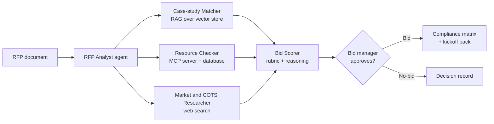

# Open Bid Agent

**An open-source, agentic AI assistant for bid management.** It reads an RFP, recommends bid or no-bid with its reasoning, builds the compliance matrix, and drafts the kickoff pack, with a human approving every key decision.

> **Status:** early development. Features are being built in the open; see the [Roadmap](#roadmap) for progress.

---

## Why this project

Bid teams lose days on the same early-stage work for every RFP:

- Reading a 100-page RFP to pull out requirements, deadlines and evaluation criteria
- Deciding whether to bid at all, often on gut feel rather than a consistent rubric
- Checking whether the right people are available and which past case studies fit
- Researching competitors and whether an off-the-shelf product already solves the problem
- Building the compliance matrix and kickoff material before the real writing starts

Open Bid Agent automates this first mile so bid managers can spend their time on win strategy, not document wrangling.

## What it will do

| Capability | Description |
| --- | --- |
| RFP analysis | Extracts scope, requirements, deadlines, mandatory criteria and evaluation weights from RFP documents |
| Bid / no-bid recommendation | Scores the opportunity against a configurable qualification rubric and explains the result |
| Case-study matching | Finds the most relevant past case studies using retrieval-augmented generation (RAG) |
| Resource check | Queries a resource-availability database through an MCP server |
| Competitor and COTS scan | Researches likely competitors and existing off-the-shelf solutions |
| Compliance matrix | Generates a requirement-by-requirement compliance matrix |
| Kickoff pack | Drafts the bid kickoff summary: timeline, roles, win themes, open questions |
| Human-in-the-loop | A bid manager reviews and approves the recommendation before anything is generated |

## Architecture

Specialised agents work under an orchestrator. Each agent does one job, and the bid scorer combines their findings with a transparent, configurable rubric.

## Tech stack

The stack is open source by default, with the model layer pluggable so you can run it free on your own machine or switch to a cloud model.

| Layer | Default (free, local) | Optional |
| --- | --- | --- |
| LLM | Llama / Qwen via Ollama | AWS Bedrock, Google Gemini, OpenAI |
| Agent orchestration | LangGraph | |
| Tools | Model Context Protocol (MCP) | |
| Vector store | Chroma | pgvector |
| Database | SQLite | PostgreSQL |
| Document parsing | Docling / PyMuPDF | |
| UI | Streamlit | |
| Tracing and evaluation | Langfuse, promptfoo | |

## Roadmap

- [x] Repository set up
- [ ] **Phase 1 – RFP analysis:** parse an RFP and extract structured requirements
- [ ] **Phase 2 – Compliance matrix:** generate a requirement-by-requirement matrix
- [ ] **Phase 3 – Case-study matching:** RAG over a case-study library
- [ ] **Phase 4 – Resource check:** MCP server over a resource-availability database
- [ ] **Phase 5 – Market and COTS scan:** web research agent
- [ ] **Phase 6 – Bid / no-bid scorer:** rubric-based recommendation with human approval
- [ ] **Phase 7 – Kickoff pack and UI:** Streamlit app and kickoff document generation
- [ ] **Phase 8 – Evaluation and cloud deployment:** test set, tracing, and an AWS deployment option

## Data and privacy

This project uses **publicly available RFPs** (for example from government procurement portals) and **synthetic** case studies and resource data. It contains no confidential or client data from any organisation. Running the default local model means your documents never leave your machine.

## Getting started

Setup instructions will be added as Phase 1 lands. You will need:

- Python 3.12+
- [Ollama](https://ollama.com) with a local model (for example `llama3.1:8b`)

## Contributing

Ideas, issues and pull requests are welcome, especially from people who work in bids, proposals and presales. Open an issue to discuss a change before starting larger work.

## License

Licensed under the [Apache License 2.0](LICENSE).

## Author

Created and maintained by **Deepman Singh**, bid and presales leader with a background in cloud transformation and software engineering.